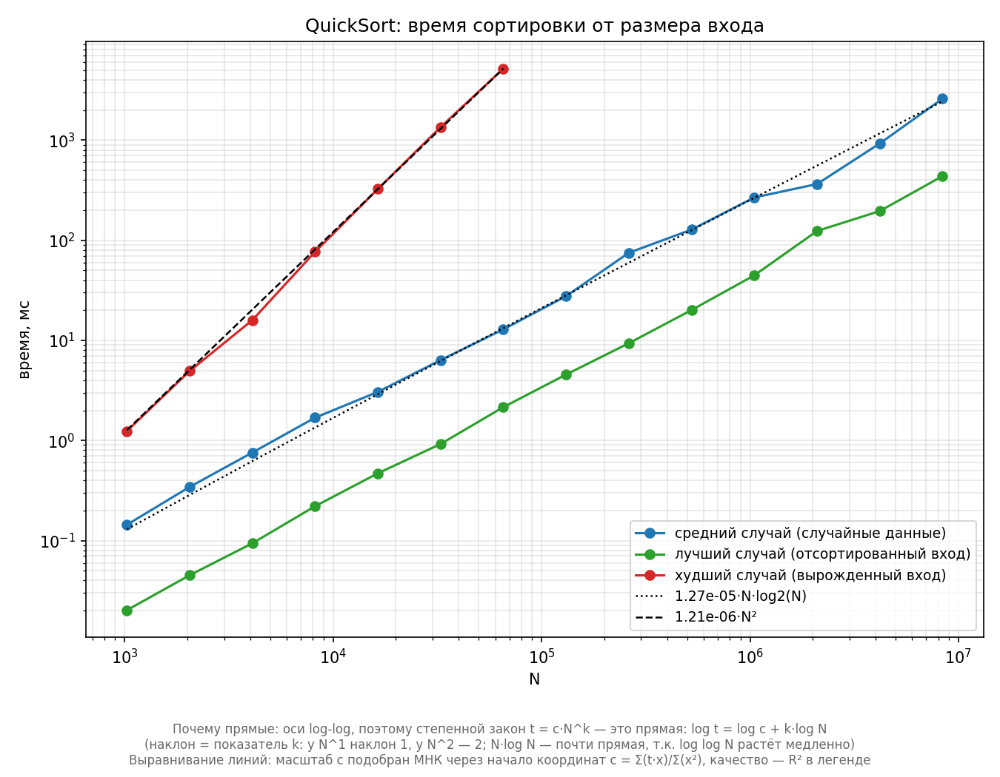

# practice-01 — QuickSort: экспериментальная сложность

Замеряем время сортировки и сравниваем с кривыми `N·log₂N` и `N²`.

## Итог



| Сценарий | Наклон `t ~ Nᵏ` | R²(N·logN) | R²(N²) | Вывод |
|---|---|---|---|---|
| sorted | 1.11 | 0.996 | 0.910 | **O(n log n)** |
| random | 1.05 | 0.981 | 0.972 | **O(n log n)** |
| worst_case | 2.02 | 0.924 | 1.000 | **O(n²)** |

**Как читать таблицу.** *Наклон k* — из прямой `log t = k·log N` на log-log графике: k ≈ 1 → рост около линейного, k ≈ 2 → квадратичный.
*R²* — коэффициент детерминации (0…1), насколько точно теоретическая кривая `N·log₂N` или `N²` проходит через замеры: чем ближе к 1, тем лучше.
Сравниваем два R² в строке: **чей больше — тот закон и описывает данные** (sorted: 0.996 > 0.910 → O(n log n); worst_case: 1.000 > 0.924 → O(n²)).
Наклон — косвенная проверка, разница R² — прямое сравнение двух гипотез на одних точках.
У random разрыв меньше (0.981 против 0.972): «случайные» замеры шумнее, но направление вывода то же.

Сырой CSV и все 4 графика — в [`results/`](results/).

## Сценарии

| Сценарий | Вход | Почему |
|---|---|---|
| `sorted` | `[0..N-1]` | пивот из середины → разбиения сбалансированы |
| `random` | случайные числа (seed = 20261003) | типичный вход, воспроизводимо |
| `worst_case` | перестановка из `WorstCaseBuilder` | пивот = минимум окна → разбиение 0 : N−1 |

## Код

- `Main.quickSort` — схема Хоара, пивот `a[left + (right-left)/2]`;
- `Benchmark` — 30 замеров на N = 2¹⁰…2²³ (worst_case: до 2¹⁶), разогрев 3+10 → CSV;
- `WorstCaseBuilder` — вход с вырожденными разбиениями (глубина рекурсии ~N);
- `plot.py` — графики: log-log, аппроксимация `t ~ Nᵏ`, нормировка, сводный.

## Запуск

Нужны **JDK 21, Maven, Python 3.10+**.
Все команды выполняются **из корня репозитория** и без комментариев —
так их можно запускать кликом прямо из README в IDE.

Тесты (51 шт.):

```bash
mvn -pl practice-01 test
```

Замеры (перезаписывает `practice-01/results/benchmark_results.csv`):

```bash
mvn -pl practice-01 compile exec:exec
```

Графики (зависимости ставятся один раз):

```bash
pip install -r practice-01/requirements.txt
python practice-01/plot.py
```
